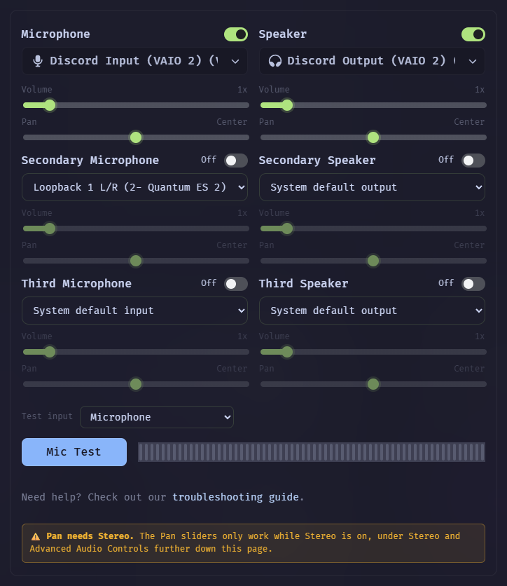
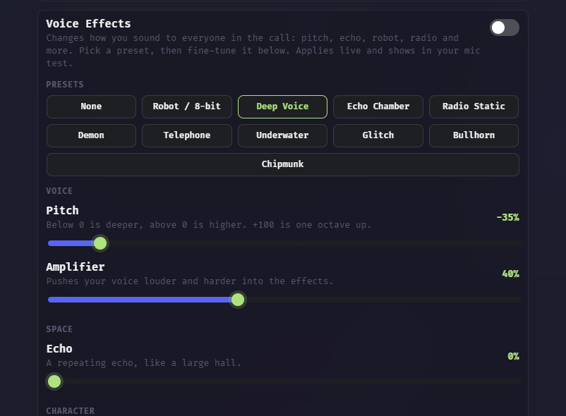
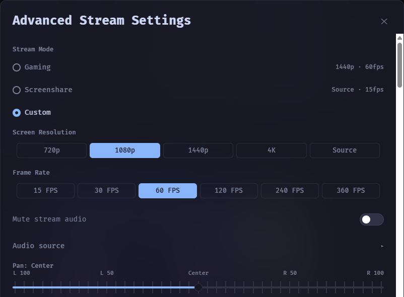

# HaloCord

**A Discord client for Windows, built for voice.**

Stereo voice up to 96 kHz, extra mics and speakers with their own pan, voice effects and Go Live controls.

## Installation

1. Download `HaloCord-Setup` from the [latest release](https://github.com/DavidHiFi/HaloCord/releases/latest).
2. Run it. The installer is not code signed, so Windows SmartScreen may stop it. Choose **More info**, then **Run anyway**.
3. Pick an install folder, finish the setup and log in with your Discord account.

To build it yourself, follow [docs/building.md](docs/building.md).

## Features

### Voice

- **Stereo voice:** 510 kbps stereo Opus, with control over bitrate, sample rate, frame time, complexity, FEC, DTX and CBR.
- **Voice card:** Microphone and Speaker side by side, each with volume, pan and an on/off switch.
- **Extra mics:** send a Secondary and Third Microphone into the call along with your main one.
- **Extra speakers:** play calls on a Secondary and Third Speaker at the same time.
- **Hard pan:** pan any mic or speaker fully to one ear; it needs Stereo on.
- **Mic boost and EQ:** input volume up to 1000% and a 16-band EQ.
- **Raw mic:** switch off Windows and Discord echo cancellation, noise suppression and auto gain.
- **Voice effects:** pitch, echo, robot, bitcrush, muffle, static and ten presets, applied live.
- **Mic Test:** hear yourself through HaloCord's own volume, EQ, effects and pan, with a stereo left and right meter.
- **Deafen while testing:** choose whether the Mic Test deafens you.
- **Pick the test mic:** right-click the Mic Test Loopback button next to your name to choose which mic to test.
- **User volume:** turn anyone up to 1000%, and reset them with the button by the slider or by right-clicking.
- **Voice messages:** record and send voice messages from the chat bar, with a mic picker.
- **Call guards:** locally mute people who send stereo noise or blast their mic, and skip friends or anyone you list.

### Streaming and camera

- **Go Live controls:** pick Gaming or Screenshare mode, or set resolution up to 4K and 15 to 360 FPS yourself.
- **Stream sound:** a window share sends only that app's sound, and a screen share sends everything except HaloCord.
- **Stream pan:** a Pan slider in Advanced Stream Settings moves your stream's sound left or right.
- **Camera:** up to 4K at 60 FPS or 1080p at 120 FPS, with an unmirrored self-view option in Video Settings.
- **Hardware encoding:** NVIDIA cards encode the camera and stream in hardware, and game shares hold their frame rate.

### Desktop app

- **In-game overlay:** voice channel members and message pop-ups over windowed and borderless games.
- **Background keybinds:** your keybinds and push to talk work while HaloCord is in the background.
- **Stream Deck:** the Elgato Stream Deck Discord plugin works, including mute, deafen, push to talk and soundboard.
- **Acrylic window:** a blurred, see-through background on Windows 11.
- **Updates:** HaloCord downloads new releases and installs them when you restart it.

### Plugins and themes

- **Plugins:** hundreds built in, from [Vencord](https://github.com/Vendicated/Vencord), [Equicord](https://github.com/Equicord/Equicord) and [TestCord](https://codeberg.org/Testcord/TestCord), plus HaloCord's own.
- **MochaCord theme:** [MochaCord Theme](https://github.com/DavidHiFi/MochaCord-Theme), a [Catppuccin](https://github.com/catppuccin/catppuccin) Mocha theme, ships built in and updates hourly; turn it on under Themes and set its options from the cog.
- **HaloCord theming:** one switch in Themes turns the HaloCord look on or off.
- **Fonts:** pick the UI font and the code font in Themes.
- **HaloCord badges:** HaloCord Owner and Contributor badges on the profiles of the people who build it.
- **Privacy:** settings stay on your PC, Discord's telemetry is blocked by default, and HaloCord runs no server.

## Notes

> [!WARNING]
> **Third-party client.** Discord does not support third-party clients. Spam-like behavior, such as mass friend requests, can get an account actioned. Use HaloCord at your own risk.

> [!NOTE]
> **Updates.** With **Update automatically** on, HaloCord downloads each release in the background, checks it against the SHA-256 published with it, and installs it the next time you restart or close the app. **Settings > Updater** has **Check for updates** and **Update and restart**. Your settings live in `%APPDATA%\HaloCord` and survive updates. On 2.8.4 or older, install the latest release by hand once.

> [!NOTE]
> **Plugin checks.** Every 6 hours a GitHub workflow loads Discord and tests every plugin's patches. When a Discord update breaks one, an issue opens with the list and closes once it is fixed. New changes from Equicord (which include Vencord's) and TestCord arrive each day as pull requests.

<b>What is in this repo</b>

 

The root follows the Vencord and Equicord layout, so upstream changes merge cleanly.

| Folder | What it holds |
|---|---|
| `src/` | The mod layer, APIs and every built-in plugin. |
| `src/plugins/` | Plugins from Vencord. |
| `src/equicordplugins/` | Plugins from Equicord. |
| `src/testcordplugins/` | TestCord plugins and HaloCord's own plugins. |
| `scripts/` | Build, lint and the patch reporter. |
| `desktop/` | The Windows app: the base Electron shell, HaloCord's shell code, icons and the installer build. |
| `docs/` | Build steps and README images. |

## Contributing

Bug reports with your HaloCord version and a screenshot help most right now.

## Star history

Thank you for starring the repo.

<a href="https://www.star-history.com/?repos=DavidHiFi%2FHaloCord&amp;type=date">
  <picture>
    <source media="(prefers-color-scheme: dark)" srcset="https://api.star-history.com/chart?repos=DavidHiFi/HaloCord&amp;type=date&amp;theme=dark&amp;legend=top-left" />
    <source media="(prefers-color-scheme: light)" srcset="https://api.star-history.com/chart?repos=DavidHiFi/HaloCord&amp;type=date" />
    
  </picture>
</a>

## Credits

- **Author:** Myself, [DavidHiFi](https://github.com/DavidHiFi)
- **Contributors:** [SickoHours](https://github.com/SickoHours), [Dx](https://github.com/DxRx99) (TestCord's owner), and the AI coding agents Claude Code and OpenHands

| Who | What |
|---|---|
| **[Kurtzon](https://github.com/kurtzonaudio) and [UNP Beats UK](https://www.youtube.com/@unpbeatsuk)** | Made [Kurtcord](https://github.com/kurtzonaudio/kurtcord), the desktop shell and voice engine HaloCord is built on. Its MIT notice is in [desktop/LICENSE](desktop/LICENSE). |
| **[Vencord](https://github.com/Vendicated/Vencord) contributors** | The mod framework and the plugins in `src/plugins/`. |
| **[Equicord](https://github.com/Equicord/Equicord) contributors** | The base this repo tracks and the plugins in `src/equicordplugins/`. |
| **[TestCord](https://codeberg.org/Testcord/TestCord) contributors** | The plugins in `src/testcordplugins/`. |
| **[Catppuccin](https://github.com/catppuccin/catppuccin)** | The Mocha palette behind the built-in MochaCord theme. |
| **Sudocord** | The layout of the Updater page header and its status pills. |
| **[Niels Martignène](https://github.com/Koromix/koffi)** | koffi, which the shell uses to call Windows for the acrylic window. |

Built on [Electron](https://www.electronjs.org/), running [Discord](https://discord.com)'s web app, with [Equicord](https://github.com/Equicord/Equicord), [pnpm](https://pnpm.io/), [koffi](https://koromix.dev/koffi) and [electron-builder](https://www.electron.build/).

> Missing or wrong credit? [Open an issue](https://github.com/DavidHiFi/HaloCord/issues/new) and I'll fix it.

## Disclaimers

HaloCord's own changes are written with AI coding agents (Claude Code and OpenHands) working for the repo owner, who directs and tests every build.

The [MochaCord Theme](https://github.com/DavidHiFi/MochaCord-Theme) is a separate project. Old links to `MochaCord.css` in this repo forward to it.

Client mods break Discord's Terms of Service. If your account matters to you, think before you use any of them. Discord is a trademark of Discord Inc., named here only to say what HaloCord works with.

 
Not affiliated with Discord. Requires a Discord account.

