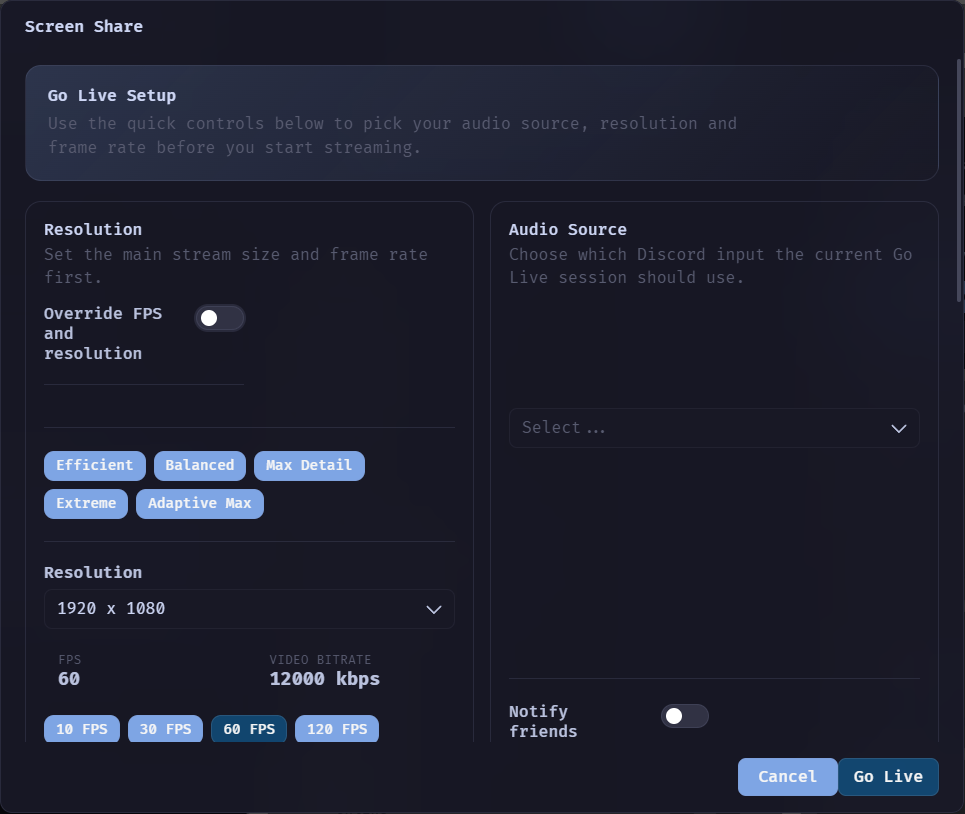

#  HaloCord

**A Discord client for Windows, built for voice.**

Stereo voice up to 96 kHz, call guards, voice effects, Go Live controls and hundreds of plugins in one app.

  

---

## Installation

1. Download the `HaloCord-Setup` installer from the [latest release](https://github.com/DavidHiFi/HaloCord/releases/latest).
2. Run it. The installer is not code signed, so Windows may show a SmartScreen warning: choose **More info**, then **Run anyway**.
3. Pick an install folder, finish the setup and log in with your Discord account.

To build it yourself, follow [docs/building.md](docs/building.md).

## Features

- **Stereo voice:** up to 96 kHz, with control over Opus bitrate, sample rate, frame time, complexity, FEC, DTX and CBR.
- **Voice effects:** pitch, echo, robot, bitcrush, muffle, static and ten presets, all audible in the mic test.
- **Call guards:** locally mute anyone who sends stereo noise or blasts their mic, with a list of people to leave alone.
- **Go Live controls:** pick resolution, frame rate, bitrate or a quality preset before each stream.
- **Camera:** up to 4K60 or 1080p120, without Discord's 720p cap or its automatic quality drops.
- **Microphone:** input volume up to 1000%, a 16-band EQ, up to two extra mics and a raw mode that turns off Discord's voice processing.
- **Plugins:** hundreds built in, from Vencord, Equicord and TestCord, plus HaloCord's own voice plugins.
- **Acrylic window:** a blurred, see-through background on Windows 11.
- **Privacy:** settings stay on your PC. No analytics, no telemetry and no HaloCord server.

## Notes

> [!WARNING]
> **Third-party client.** Discord does not support third-party clients. Spam-like behavior, such as mass friend requests, can get an account actioned. Use it at your own risk.

> [!NOTE]
> **Updates.** HaloCord updates itself. With **Update automatically** on, it downloads each new release in the background, checks it against the SHA-256 published with the release, and installs it the next time you restart or close HaloCord. **Settings > Updater** has **Check for updates** and **Update and restart**. Settings live in `%APPDATA%\HaloCord` and survive updates. Version 2.8.4 only shows a notice, so install 2.9.0 over it once by hand.

> [!NOTE]
> **Plugin checks.** Every 6 hours a GitHub check loads Discord and tests every plugin's patches. When a Discord update breaks one, an issue opens with the list and closes again once it is fixed. Each day, new changes from Equicord (which include Vencord's) and from TestCord arrive as pull requests and ship in the next release.

What is in this repo

The root follows the Vencord and Equicord layout, so upstream changes merge cleanly.

| Folder | What it holds |
|---|---|
| `src/` | The mod layer, APIs and every built-in plugin. |
| `src/plugins/` | Plugins from Vencord. |
| `src/equicordplugins/` | Plugins from Equicord. |
| `src/testcordplugins/` | TestCord plugins and HaloCord's own voice plugins. |
| `scripts/` | Build, lint and the patch reporter. |
| `desktop/` | The Windows app: the base Electron shell, HaloCord's shell code, icons and the installer build. |
| `docs/` | Build steps and README images. |

## Contributing

Bug reports with the client version and a screenshot help most right now.

## Star history

Thank you for starring the repo.

<a href="https://www.star-history.com/?repos=DavidHiFi%2FHaloCord&amp;type=date">
  <picture>
    <source media="(prefers-color-scheme: dark)" srcset="https://api.star-history.com/chart?repos=DavidHiFi/HaloCord&amp;type=date&amp;theme=dark&amp;legend=top-left" />
    <source media="(prefers-color-scheme: light)" srcset="https://api.star-history.com/chart?repos=DavidHiFi/HaloCord&amp;type=date" />
    
  </picture>
</a>

## Credits

- **Author:** Myself, [DavidHiFi](https://github.com/DavidHiFi)

| Who | What |
|---|---|
| **[Kurtzon](https://github.com/kurtzonaudio) and [UNP Beats UK](https://www.youtube.com/@unpbeatsuk)** | Made Kurtcord, the desktop shell HaloCord is built on. Its MIT notice is in [desktop/LICENSE](desktop/LICENSE). |
| **[Vencord](https://github.com/Vendicated/Vencord) and [Equicord](https://github.com/Equicord/Equicord) contributors** | The mod framework and plugin suites this repo is built on. |
| **[TestCord](https://codeberg.org/Testcord/TestCord) contributors** | The TestCord plugins. |
| **Sudocord** | The layout of the Updater page header and its status pills. |
| **[Niels Martignène](https://github.com/Koromix/koffi)** | koffi, which the shell uses to call Windows for the acrylic window. |

Built on [Electron](https://www.electronjs.org/), running [Discord](https://discord.com)'s web app, with [Equicord](https://github.com/Equicord/Equicord), [pnpm](https://pnpm.io/) and [electron-builder](https://www.electron.build/).

> Missing or wrong credit? [Open an issue](https://github.com/DavidHiFi/HaloCord/issues/new) and I'll fix it.

## Disclaimers

HaloCord's own changes are written with an AI coding agent (Claude Code) working for the repo owner, who directs and tests every build.

The [MochaCord Theme](https://github.com/DavidHiFi/MochaCord-Theme) is a separate project: a Catppuccin Mocha theme for Vencord-based clients. Old links to `MochaCord.css` in this repo forward to it.

Client mods are against Discord's Terms of Service. If your account matters a lot to you, think before you use any of them. Discord is a trademark of Discord Inc., named here only to say what HaloCord works with.

 
Not affiliated with Discord. Requires a Discord account.

